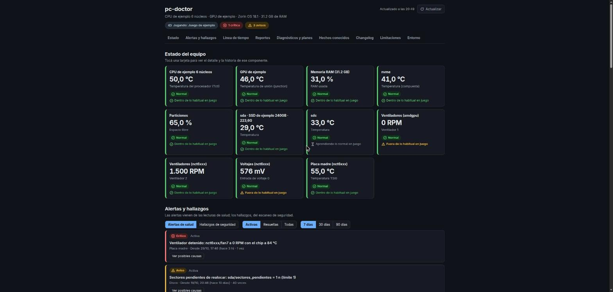
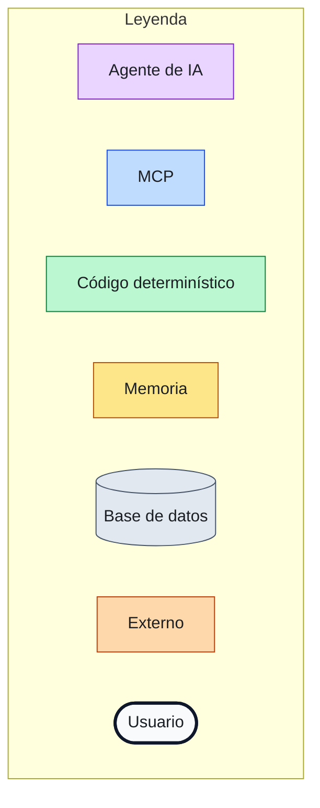
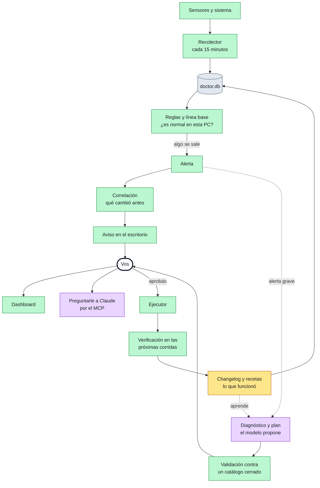
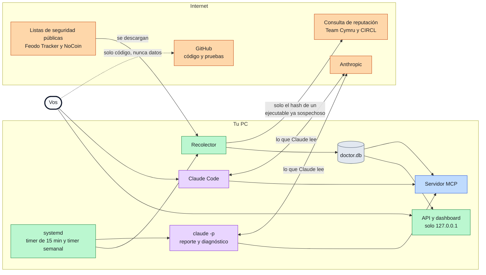
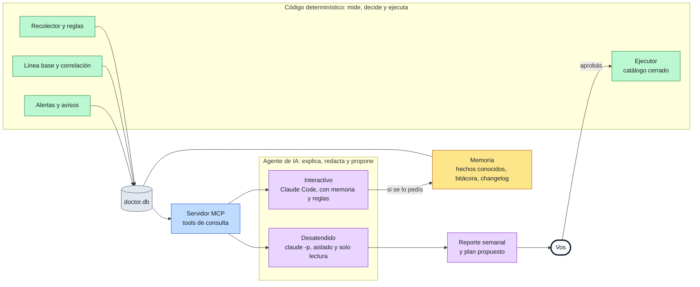

# pc-doctor

**Un médico de cabecera para tu PC, con memoria y un agente de IA.**


pc-doctor mide la salud de tu equipo, aprende qué es normal *en tu PC*, te avisa cuando algo se sale y te deja preguntarle a Claude qué pasó. Todo corre y se guarda en tu máquina.

## Qué hace
- **Vigila el hardware** (CPU, GPU, discos, RAM, ventiladores, voltajes) y **aprende qué es normal** para tu PC: en reposo, con carga y jugando.
- **Detecta lo raro:** mineros de criptomonedas, procesos fantasma, posibles keyloggers y puertos expuestos.
- **Explica una alerta:** junta lo que cambió antes (un kernel, un driver, un paquete, otra alerta) y lo ordena, sin inventar causas.
- **Te avisa en el escritorio**, sin ruido: las alertas se agrupan y no se repiten.
- **Tiene un dashboard local** con el estado de cada componente, gráficos con la banda de lo normal y una línea de tiempo.
- **Le podés preguntar a Claude** por tu PC: más de 40 tools le dan acceso a todo lo medido.
- **Arma un reporte semanal** solo, con plan B si Claude no está disponible.
- **Recuerda lo que ya sabés:** si declarás que un disco anda mal y lo tenés asumido, no te lo repite hasta que empeore.
- **Propone arreglos y vos decidís:** ante una alerta grave arma un plan con acciones de un catálogo cerrado, lo aplica solo si lo aprobás y comprueba que funcionó.

## Así se usa
Le hablás a Claude Code con el servidor MCP conectado. Respuestas de ejemplo, resumidas:

> **¿Por qué se calentó la GPU ayer?**
> Llegó a 88 °C a las 22:10, unos grados por encima de lo normal jugando. Esa tarde se actualizó el driver de video y, a la misma hora, empezó una sesión de juego de dos horas. Es una coincidencia en el tiempo, no una causa probada: yo miraría primero el driver.

> **¿Hay algo raro corriendo?**
> Nada marcado como malicioso. Hay dos puertos escuchando hacia la red local (un servicio de streaming de Steam y SSH), los dos conocidos desde hace semanas. Ningún proceso corre desde `/tmp`.

> **¿Qué cambió en el sistema esta semana?**
> Se actualizó el kernel el martes y se instalaron 14 paquetes, entre ellos el driver de video. Desde entonces el ventilador de la caja gira un 10 % más rápido en reposo.

> **El disco de datos tiene sectores dañados, ya lo sé.**
> Lo dejo anotado como conocido: no te lo voy a repetir mientras no empeore. Si aparece un sector más, te aviso.

## El dashboard


*Captura con datos sintéticos.* Corre en `http://localhost:8787`, se puede instalar como app y las notificaciones pueden abrir directo la alerta.

## Cómo funciona
Los colores significan lo mismo en los tres diagramas:



### 1. El ciclo de trabajo
Cada 15 minutos el recolector lee los sensores y compara con lo que es normal en tu PC. Si algo se sale, salta una alerta, se busca qué cambió antes y se te avisa. Si es grave, el modelo propone un plan, pero lo valida el código y lo aprobás vos.



### 2. Qué corre dónde y qué sale de tu PC
Todo vive en tu máquina. Hacia afuera solo cruzan tres cosas: la descarga de listas públicas de seguridad, el hash de un ejecutable que ya era sospechoso y lo que Claude lee cuando le preguntás algo o se genera el reporte.



### 3. Dónde interviene la IA y dónde no
**Medir, decidir y alertar no depende del modelo:** lo hace código que podés leer y probar. El modelo explica, redacta y propone. Se usa de dos maneras: interactivo (Claude Code, con memoria y reglas) y desatendido (`claude -p`, aislado y de solo lectura). Nada se ejecuta sin que vos apruebes.



## Privacidad y seguridad
- **Todo queda en tu PC:** la base, los reportes y el dashboard. No hay ningún servicio de pc-doctor al que se suba nada.
- **Online, casi nada:** solo se consulta el *hash* de un ejecutable que ya estaba marcado como sospechoso (nunca el archivo) y se descargan dos listas públicas de seguridad. Si le preguntás algo a Claude, lo que lee viaja a Anthropic como en cualquier conversación.
- **Dashboard solo en `localhost`:** escucha en `127.0.0.1` y rechaza cualquier otro origen. Lo único que escribe (aprobar, rechazar o deshacer un plan) exige un token local.
- **El agente desatendido solo lee:** `claude -p` corre sin herramientas de escritura y todo lo que ve se trata como dato no confiable, porque un nombre de proceso podría traer una orden disfrazada.
- **Nada se borra y no hace falta `sudo`:** las limpiezas mueven a una cuarentena que se puede restaurar. El modelo propone, pero solo ejecuta código de pc-doctor, con parámetros validados y con tu aprobación.

## Instalación
Necesitás `uv`, `lm-sensors` y `lshw`, y Claude Code si querés consultarlo por conversación.

```bash
git clone https://github.com/AndresAlvarezRo/pc-doctor && cd pc-doctor
uv sync
mkdir -p ~/.config/systemd/user && cp systemd/*.service systemd/*.timer ~/.config/systemd/user/
systemctl --user daemon-reload && systemctl --user enable --now pc-doctor.timer pc-doctor-reporte.timer pc-doctor-web.service
claude mcp add pc-doctor -s user -- uv run --directory "$PWD" server.py
```

Funciona mejor en Linux (pensado para Ubuntu y derivados; probado en Zorin OS). Hay un paquete para Windows, pero todavía no se verificó en una PC real y la parte de seguridad y el reporte no están portados. La guía completa está en [docs/OPERACION.md](docs/OPERACION.md).

## Stack
| Pieza | Tecnología |
|---|---|
| Recolector, reglas y línea base | Python 3.10+, psutil, SQLite |
| Servidor MCP | SDK oficial de MCP (FastMCP), 46 tools |
| Dashboard | FastAPI, React 19, TypeScript, Vite y Recharts |
| Agente | Claude Code y `claude -p` |
| Tareas programadas | systemd (timers de usuario) |
| Pruebas | pytest y GitHub Actions |

## Próximamente
- Verificar el paquete de Windows en una PC real y portar la parte de seguridad y el reporte.
- Cambiar el nivel de autonomía y las acciones preaprobadas desde el dashboard, hoy solo desde `config.json`.
- Más acciones en el dashboard (marcar alertas, restaurar la cuarentena) y una pantalla de configuración.
- Probar la remediación asistida con alertas reales y sumar pruebas del escáner de seguridad.

## Documentación
**[docs/](docs/README.md):** [arquitectura](docs/ARQUITECTURA.md), [remediación asistida](docs/REMEDIACION.md), [operación](docs/OPERACION.md) y [desarrollo](docs/DESARROLLO.md).
